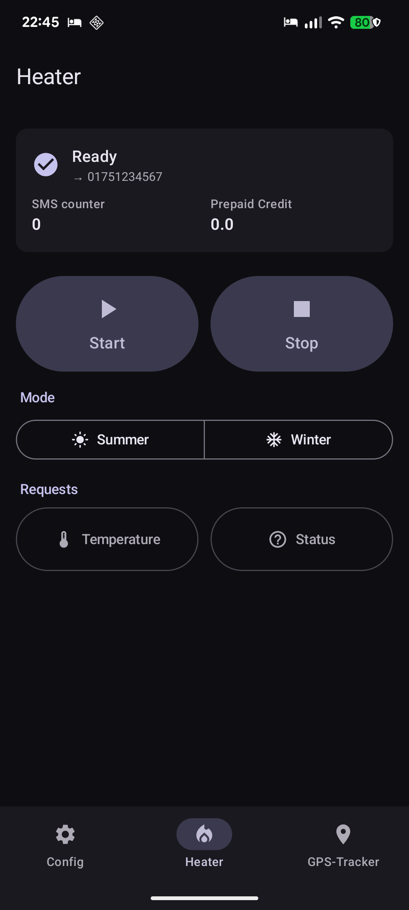
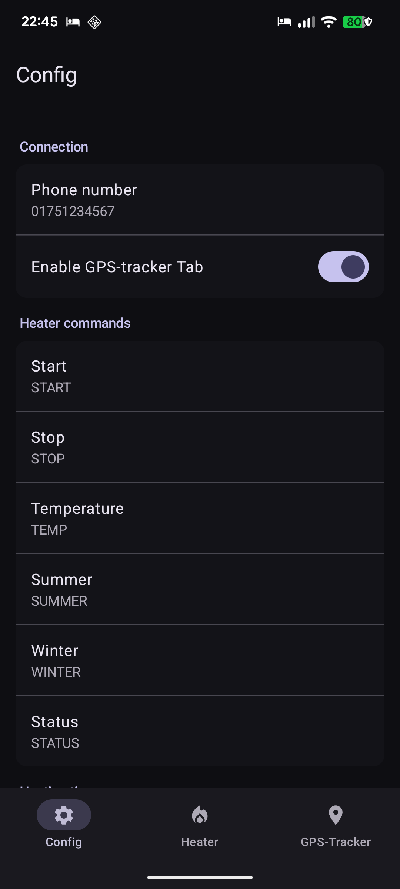
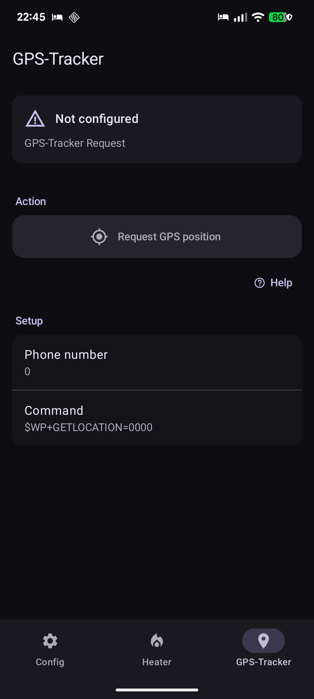

# Preheat

Send SMS commands to your auxiliary heater straight from your Android phone.

[](LICENSE)
[](https://apilevels.com/)
[](https://kotlinlang.org/)
[](https://developer.android.com/jetpack/compose)

<p align="center">
  
  
  
</p>

## Features

- Manual heater commands over SMS: Start, Stop, Summer, Winter, Temperature request, Status request
- GPS position request for compatible GPS trackers (Waypoint `$WP+GETLOCATION` protocol)
- Per-command text fully configurable — works with any heater that accepts text-message commands
- Optional SMS counter with monthly limit and prepaid-credit tracking
- Localized in English, German, Spanish, French, and Italian
- Material You dynamic color, follows system light/dark theme
- Edge-to-edge, single-Activity Compose UI

## Requirements

- Android 12 (API 31) or newer
- A SIM that can send SMS to the heater's phone number
- The heater (or its GSM module) accepting plain text commands

## Building

### With Nix (recommended)

The repo ships a `flake.nix` that pins the Android SDK, JDK 17, and the Android command-line tools.

```sh
nix develop
./gradlew assembleDebug
```

The devshell sets `ANDROID_USER_HOME` and `GRADLE_USER_HOME` inside the repo, so it leaves no global Android state behind.

### Without Nix

Provide JDK 17 and an Android SDK with platform 36 and build-tools 36.0.0, then:

```sh
./gradlew assembleDebug
```

The APK lands in `app/build/outputs/apk/debug/`.

## Tech stack

| Layer        | Choice |
| ------------ | ------ |
| Language     | Kotlin 2.3.21 |
| UI           | Jetpack Compose (BOM 2026.05.01), Material 3 |
| Architecture | Single Activity + per-screen ViewModel |
| Persistence  | androidx.datastore (Preferences) |
| Build        | AGP 9.2.1 / Gradle (Kotlin DSL) |
| Min / Target | Android 12 (API 31) / Android 16 (API 36) |

## License

GPL-2.0 — see [LICENSE](LICENSE).
